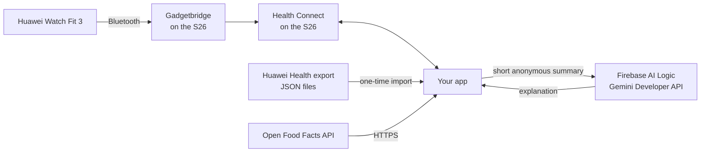
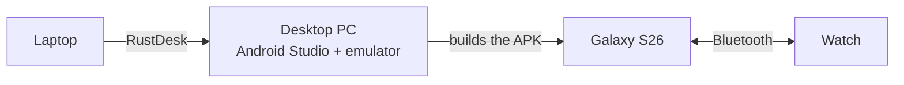

# Fitness Hub – Project Plan

A free, privacy-first Android fitness app for gym-goers. It collects data from a Huawei Watch Fit 3 (and other apps) through Health Connect, adds a full gym workout logger, nutrition tracking, charts and sharing, and includes an **AI coach** that explains why your lifts are or aren't progressing, using your own data.

- Phone: Samsung Galaxy S26
- Watch: Huawei Watch Fit 3
- Target: working app by mid-December 2026, with a buffer week before the deadline
- Total cost: €0

---

## 1. The idea in one paragraph

The watch already measures steps, heart rate, sleep and calories very well, so the app does **not** recalculate them. Instead it acts as a **hub**: it collects data from several free sources, stores it locally, removes duplicates, and adds what the watch doesn't do: gym logging (sets, reps, weight, custom training days), goals, food logging, trends, and an AI coach that connects the dots ("your bench is stuck because…"). It also writes its own data (workouts, meals) back to Health Connect, so other apps benefit too. That makes it a "connector" in both directions.

---

## 2. Architecture (four free pipes)



| Pipe | Source | What it gives | Cost |
|---|---|---|---|
| 1. Live data | Watch → Gadgetbridge → Health Connect | Steps, distance, heart rate, SpO2, calories, sleep, workouts | Free |
| 2. History | Huawei Health data export | Older data from before switching to Gadgetbridge | Free |
| 3. Nutrition | Open Food Facts API | Food search, barcode lookups, nutrition values | Free |
| 4. AI coach | Gemini Developer API through Firebase AI Logic (Spark plan) | Plain-language explanations of your progress | Free (rate-limited) |

**Key points**
- Your app never talks Bluetooth. Gadgetbridge handles the watch; your app only reads Health Connect.
- The AI never sees raw data. The app computes the facts locally and sends only a short, anonymous summary.

---

## 3. Your setup: laptop + PC + RustDesk + phone + watch

### How the pieces connect



- **Bluetooth only happens between the watch and the phone.** The PC is never involved, so it doesn't matter how far you are from it.
- **The PC only builds the app.** Android Studio runs there; the laptop is just a screen and keyboard through RustDesk.
- **The phone doesn't stay connected to anything.** It only needs a connection to install a new version or to show logs.
- **RustDesk can't pass a USB phone through to the PC**, and ADB doesn't work over Bluetooth. That's why the options below exist.

### Four ways to get a new version onto the phone

**A. At home (phone on the same Wi-Fi as the PC): wireless debugging**
1. On the S26: Settings > About phone > Software information > tap *Build number* 7 times to unlock Developer options.
2. Developer options > turn on **Wireless debugging**.
3. In Android Studio (on the PC, through RustDesk): Device Manager > **Pair devices using Wi-Fi** > scan the QR code or use the pairing code.
4. Press Run and see Logcat live, exactly as if the phone were plugged in.

**B. Anywhere: build in the cloud, install on the phone**
1. Push your code to a **private** GitHub repository.
2. Add the workflow below. Every push builds a debug APK in the cloud for free (private repos get 2,000 free minutes per month on the Free plan).
3. On the phone: GitHub > Actions > latest run > download the `app-debug` artifact > install it (allow "Install unknown apps" for that app once).
4. Bonus: edit code on the laptop in a lightweight editor (VS Code) and let GitHub build it, so you don't always need the PC.

`.github/workflows/build.yml`:

```yaml
name: Build debug APK
on:
  push:
    branches: [ main ]
  workflow_dispatch:
jobs:
  build:
    runs-on: ubuntu-latest
    steps:
      - uses: actions/checkout@v4
      - uses: actions/setup-java@v4
        with:
          distribution: temurin
          java-version: 17
      - uses: gradle/actions/setup-gradle@v4
      - name: Add google-services.json from secret
        run: echo "${{ secrets.GOOGLE_SERVICES_JSON }}" | base64 -d > app/google-services.json
      - run: chmod +x ./gradlew && ./gradlew assembleDebug
      - uses: actions/upload-artifact@v4
        with:
          name: app-debug
          path: app/build/outputs/apk/debug/app-debug.apk
```

*(Store `google-services.json` base64-encoded as a GitHub secret named `GOOGLE_SERVICES_JSON` instead of committing it. Check for newer action versions when you set it up.)*

**C. Away from home with logs: phone plugged into the laptop by USB**
1. On the laptop, install **scrcpy** (it includes ADB). It's a small download and very light on resources. You'll use it for the presentation too.
2. Get the APK onto the laptop: RustDesk's file transfer from the PC, or download it from GitHub (option B).
3. Plug the phone into the laptop (allow USB debugging when asked) and run:
   ```
   adb install -r app-debug.apk
   adb logcat
   ```
   The second command shows live logs, which option B doesn't give you.

**D. Without the phone at all: the emulator on the PC**
- Create an emulator with **Android 14 or newer**. Health Connect is built in.
- Add a debug-only **"Seed test data"** button that writes fake steps, heart rate, sleep and a few weeks of gym sessions. You can build every screen without the watch.
- The emulator runs on the PC, so your laptop's resources aren't the problem.

### Debugging tips
- A debug-only **Log screen** in the app showing the last ~200 log lines (sync times, errors, record counts). Never log actual health values.
- A "Last synced: 14:32 – 1,240 records" line on the dashboard, so you can tell at a glance whether data is flowing.

---

## 4. Tech stack (all free)

| Part | Choice |
|---|---|
| Language | Kotlin |
| UI | Jetpack Compose + Material 3 |
| Architecture | MVVM + Repository |
| Health data | Health Connect client library (`androidx.health.connect:connect-client`) |
| Local database | Room |
| Background sync | WorkManager |
| Charts | Vico |
| Network | Retrofit + OkHttp (or Ktor) |
| JSON | kotlinx.serialization |
| Barcode scanning | CameraX + ML Kit Barcode Scanning (free, on-device) |
| AI coach | Firebase AI Logic SDK → Gemini Developer API (Spark plan, no card) |
| API protection | Firebase App Check (Play Integrity; debug provider for debug builds) |
| Dependency injection | Hilt (optional) |
| CI builds | GitHub Actions |
| Watch bridge | Gadgetbridge (installed on the phone, not part of your code) |
| Presentation | scrcpy (phone mirroring on the laptop) |

---

## 5. Features mapped to the project brief

| Brief feature | How the app does it |
|---|---|
| Activity tracking | Daily steps, distance, active calories from Health Connect |
| Workout logging | Full gym logger: exercises, sets × reps × weight, RPE, rest timer, custom training days (section 6) |
| Nutrition tracking | Food search and barcode scan via Open Food Facts, saved locally and as `NutritionRecord` in Health Connect |
| Goal setting | Daily/weekly goals (steps, sleep, training days, protein, calories) with progress rings and streaks |
| Health metric monitoring | Heart rate (avg, resting), SpO2, sleep duration and stages; heart rate and calories attached to each gym session |
| Social sharing | Generates a summary card image (e.g. "New bench PR!") and opens Android's share sheet |
| Data visualisation | Day / week / month charts, estimated 1RM per exercise, volume per muscle group |
| Wearable integration | Huawei Watch Fit 3 through Gadgetbridge → Health Connect |
| AI insights | AI coach explains plateaus and answers questions using your data (section 7) |
| "Connector" | Reads from any app that writes to Health Connect; writes workouts and meals back |

---

## 6. Gym workout logger

### Screens
1. **Today** – shows the workout planned for today's weekday (from your custom days), or "Rest day".
2. **Active workout** – log each set (reps, weight, optional RPE, warm-up toggle), previous session's numbers shown next to each set, rest timer with vibration.
3. **Custom days (templates)** – create days like "Push A", "Pull A", "Legs", pick exercises, target sets and rep range, assign weekdays.
4. **Exercise library** – common exercises preloaded (name, type, muscle group, equipment) + add your own.
5. **Exercise history** – chart of estimated 1RM, top set and volume over time; personal records.

### Room tables
- `exercise` – id, name, type (compound/isolation), primaryMuscle, equipment (barbell/dumbbell/machine/cable/bodyweight), isCustom
- `workout_template` – id, name ("Push A"), weekdays, notes
- `template_exercise` – templateId, exerciseId, order, targetSets, targetRepsMin, targetRepsMax, restSeconds
- `workout_session` – id, templateId (nullable), start, end, notes, avgHr, maxHr, kcal (filled from Health Connect)
- `set_entry` – sessionId, exerciseId, setNumber, reps, weightKg, rpe (nullable), isWarmup, completedAt

Preload the library from a small JSON file you write yourself (~40 common exercises, your own descriptions).

### Calculations (all local)
- **Estimated 1-rep max (Epley):** `weight × (1 + reps / 30)`. Most reliable for sets of about 10 reps or fewer.
- **Volume:** sum of `reps × weight` for working sets (skip warm-ups).
- **Weekly sets per muscle group:** count of working sets per primary muscle.
- **Progression hint (double progression):** when every set of an exercise hits the top of its rep range for two sessions in a row, suggest adding the smallest weight step (e.g. +2.5 kg).

### Hub bonus: watch data per session
After a session ends, query Health Connect for `HeartRateRecord` and `TotalCaloriesBurnedRecord` between the session's start and end → store average/max heart rate and calories on the session. Then write the session to Health Connect as an `ExerciseSessionRecord` (strength training), so other apps can see it.

---

## 7. AI coach ("Why am I not progressing?")

### Design: two layers
1. **Plateau detector (plain Kotlin, no AI, works offline).** It finds the facts.
2. **Gemini (through Firebase AI Logic).** It explains the facts in plain language and answers follow-up questions.

Why this design: answers are grounded in real numbers instead of AI guesses, the AI receives very little personal data, and the coach still works (without the explanation part) when there's no internet or the free quota runs out.

### Layer 1: plateau detector

```kotlin
fun epley1RM(weightKg: Double, reps: Int) = weightKg * (1 + reps / 30.0)

// bestPerSession = best estimated 1RM for one lift in each session
fun isPlateau(bestPerSession: List<Pair<LocalDate, Double>>, today: LocalDate): Boolean {
    val recent = bestPerSession
        .filter { it.first > today.minusWeeks(2) }
        .maxOfOrNull { it.second } ?: return false
    val before = bestPerSession
        .filter { it.first in today.minusWeeks(4)..today.minusWeeks(2) }
        .maxOfOrNull { it.second } ?: return false
    return recent < before * 1.01   // less than 1% improvement in ~4 weeks
}
```

When a lift is flat, check likely causes over the last 4 weeks:

| Signal | Source | Example of a flag |
|---|---|---|
| Sleep | Health Connect (watch) | Average under 7 h, or many short nights |
| Resting heart rate | Health Connect (watch) | Higher than your previous 4-week average (can be a sign of fatigue, stress or illness) |
| Training frequency | Gym logger | Muscle trained only ~once a week, or missed planned days |
| Weekly sets | Gym logger | Very low (or suddenly very high) sets for that muscle |
| Rep range | Gym logger | Always the same rep range for months |
| Protein & calories | Food log (if ≥ 10 days logged) | Low protein per kg of body weight, or eating well below maintenance |

Output is a small data object, e.g.:

```json
{
  "lift": "Bench press",
  "e1rm_kg_4w_ago": 92.5,
  "e1rm_kg_now": 92.0,
  "sessions_per_week": 1.5,
  "rep_range_used": "5-6 only",
  "avg_sleep_h": 6.2,
  "nights_under_7h": 19,
  "resting_hr_change_bpm": 4,
  "protein_g_per_kg": 1.2,
  "avg_kcal_vs_maintenance": -350,
  "missed_planned_sessions": 3,
  "data_missing": ["body weight trend"]
}
```

No name, no birth date, no exact timestamps, no raw heart-rate samples. Just rounded numbers.

### Layer 2: Gemini via Firebase AI Logic

**Setup (free):**
1. Firebase console > create a project on the **Spark** (no-cost) plan.
2. Add an Android app (your package name + the SHA-256 of your debug signing key) > download `google-services.json` into `app/`. Add it to `.gitignore` and use the GitHub secret from section 3B for cloud builds.
3. Firebase console > **AI Services > AI Logic > Get started** > choose **Gemini Developer API**.
4. **App Check**: the guided setup turns it on. Use the **debug provider** for debug builds (register the debug token it prints in Logcat in the Firebase console) and **Play Integrity** for release builds.
5. Pick a current **Flash / Flash-Lite** model from the Firebase AI Logic supported-models list (they change often; free-tier limits are shown in AI Studio).

With Firebase AI Logic **there's no Gemini API key inside your app**, which is the safe way to call Gemini directly from a phone without your own server.

**Dependencies (app `build.gradle.kts`):**

```kotlin
implementation(platform("com.google.firebase:firebase-bom:<latest>"))
implementation("com.google.firebase:firebase-ai")
implementation("com.google.firebase:firebase-appcheck-playintegrity")
debugImplementation("com.google.firebase:firebase-appcheck-debug")
```

**Calling the coach (sketch):**

```kotlin
private val coachModel = Firebase.ai(backend = GenerativeBackend.googleAI())
    .generativeModel(
        modelName = "<current-flash-model>",
        systemInstruction = content { text(COACH_RULES) }
    )

suspend fun askCoach(findings: CoachFindings, question: String): String {
    val prompt = buildString {
        appendLine("Training data summary (JSON):")
        appendLine(Json.encodeToString(findings))
        appendLine()
        appendLine("Question: $question")
    }
    return coachModel.generateContent(prompt).text ?: "No answer."
}
```

**Coach rules (system instruction draft):**

```
You are a gym coach inside a fitness app. Explain possible reasons for the
user's training progress using ONLY the data summary provided. Mention the
specific numbers you rely on. Give 2–4 practical suggestions about training,
sleep, recovery or nutrition. Keep answers under 200 words.
If something is missing from the data, say so instead of guessing.
You are not a doctor: do not diagnose and do not give medical advice.
If the user mentions pain, injury, dizziness, chest pain or feeling unwell,
tell them to stop training and see a doctor.
Never recommend extreme diets, very low calorie intake, drugs, or specific
supplement doses.
```

**App behaviour:**
- Quick buttons ("Why is my bench stuck?", "How was my week?") + free-text questions.
- A **"What will be sent"** preview the user can expand before sending. Great for the presentation and for privacy.
- The AI feature is **off until the user turns it on** (opt-in screen explaining what's sent and to whom).
- Chat history stored locally only, with a "Clear chat" button.
- If the request fails (no internet, free quota reached → HTTP 429), show the plateau detector's findings as plain text instead.
- A small note under every answer: "AI-generated – may be wrong. Not medical advice."

**Terms you need to respect (Gemini API terms; re-check the current version):**
- You must be **18 or older** to use the Gemini API, and the app must not be aimed at under-18s.
- The API may **not be used to provide medical advice**, so the coach stays in fitness territory.
- For users in the EEA (Romania included), Google applies its paid-tier data rules (no use of your prompts to improve products) even to the free quota.
- Apps offered to users in the EEA must use the **paid** tier. The free tier is fine for your own school project and demo; if you ever publish the app, switch to paid.
- Don't send sensitive personal info. That's exactly why the app only sends an anonymous summary.

**Optional future work:** the Galaxy S26 supports on-device Gemini Nano (ML Kit Prompt API). It could serve as an offline, fully private fallback. Mention it in the report as a next step rather than building it now.

---

## 8. Health Connect data layer

### Main interface (lets you plug in new sources later)

```kotlin
interface HealthDataSource {
    val name: String
    suspend fun isAvailable(): Boolean
    suspend fun readDailySummary(date: LocalDate): DailySummary?
    suspend fun readHeartRate(from: Instant, to: Instant): List<HeartRateSample>
    suspend fun readSleep(from: Instant, to: Instant): List<SleepSession>
    suspend fun readWorkouts(from: Instant, to: Instant): List<Workout>
}

class HealthConnectSource(...) : HealthDataSource
class HuaweiExportSource(...) : HealthDataSource   // reads imported JSON
class ManualSource(...) : HealthDataSource          // user-entered data
```

### Room tables (health cache)
- `daily_summary` – date, steps, distance, activeKcal, totalKcal, restingHr, avgHr, sleepMinutes, source
- `heart_rate_sample` – time, bpm, source
- `sleep_session` – start, end, stages (light/deep/REM/awake), source
- `food_entry` – time, name, barcode, kcal, protein, carbs, fat, meal
- `goal` – type, target, period
- `coach_message` – time, role (user/coach), text
- (gym tables: see section 6)

### Health Connect records
Read: `StepsRecord`, `DistanceRecord`, `HeartRateRecord`, `RestingHeartRateRecord`, `SleepSessionRecord`, `ActiveCaloriesBurnedRecord`, `TotalCaloriesBurnedRecord`, `ExerciseSessionRecord`, `OxygenSaturationRecord`, `WeightRecord`.
Write: `ExerciseSessionRecord` (gym sessions), `NutritionRecord` (meals).

Use **aggregate queries** for totals (steps per day etc.). Health Connect handles overlapping sources (e.g. phone + watch both counting steps).

### Permission request (sketch)

```kotlin
val permissions = setOf(
    HealthPermission.getReadPermission(StepsRecord::class),
    HealthPermission.getReadPermission(HeartRateRecord::class),
    HealthPermission.getReadPermission(SleepSessionRecord::class),
    HealthPermission.getReadPermission(TotalCaloriesBurnedRecord::class),
    HealthPermission.getReadPermission(ExerciseSessionRecord::class),
    HealthPermission.getWritePermission(ExerciseSessionRecord::class),
    HealthPermission.getWritePermission(NutritionRecord::class),
)

val launcher = registerForActivityResult(
    PermissionController.createRequestPermissionResultContract()
) { granted: Set<String> ->
    if (granted.containsAll(permissions)) startSync() else showPermissionHelp()
}
```

### Reading today's steps (sketch)

```kotlin
val client = HealthConnectClient.getOrCreate(context)
val result = client.aggregate(
    AggregateRequest(
        metrics = setOf(StepsRecord.COUNT_TOTAL),
        timeRangeFilter = TimeRangeFilter.between(startOfToday, Instant.now())
    )
)
val steps = result[StepsRecord.COUNT_TOTAL] ?: 0L
```

### Manifest requirements
- Declare each `android.permission.health.READ_*` / `WRITE_*` permission you use.
- Add the **permission rationale screen** (your privacy policy activity), which Health Connect requires:
  - Android 14+: an `activity-alias` with action `android.intent.action.VIEW_PERMISSION_USAGE` and category `android.intent.category.HEALTH_PERMISSIONS`.
  - Android 13 and lower: an activity with intent filter `androidx.health.ACTION_SHOW_PERMISSIONS_RATIONALE`.
- **History:** by default an app can only read data from about 30 days before permission was first granted. For older data request `READ_HEALTH_DATA_HISTORY`.
- **Background sync:** needs `READ_HEALTH_DATA_IN_BACKGROUND`. Check the feature is available before using it; otherwise sync when the app opens.

### Open Food Facts
- Product by barcode: `https://world.openfoodfacts.org/api/v2/product/{barcode}.json`
- No API key needed, but send a custom User-Agent like `FitnessHub/1.0 (your-email@example.com)`.
- Respect their rate limits (stricter for search than for single products). Cache results in Room.
- Data is under the Open Database License, so show a "Food data from Open Food Facts" credit.

---

## 9. Week-by-week plan

| Week | Dates | Goals | Done when… |
|---|---|---|---|
| 1 | Nov 3–9 | **Setup.** Secure RustDesk (11D). Android Studio on the PC, project, private GitHub repo, Actions workflow. scrcpy on the laptop. Firebase project (Spark) + AI Logic + App Check. Request the Huawei data export. Switch the watch to Gadgetbridge **safely** (11A). | Gadgetbridge data shows in the Health Connect app on the S26; an APK from GitHub installs on the phone. |
| 2 | Nov 10–16 | **Watch data.** Compose skeleton + navigation. Health Connect permission flow + rationale screen. Read steps, heart rate, sleep, calories. Dashboard (today). Debug log screen. Seed-data button. | Today's real watch numbers appear on screen. |
| 3 | Nov 17–23 | **Gym logger.** Exercise library, custom days (templates + weekdays), active workout screen (sets/reps/weight/RPE), rest timer. Room tables. | You can log a real gym session from start to finish. |
| 4 | Nov 24–30 | **Progress & sync.** `HealthDataSource` + repository + WorkManager sync. Exercise history charts (e1RM, volume), PRs, progression hints, goals. Attach watch heart rate/calories to sessions; write sessions to Health Connect. | Charts show your progress; sessions show heart rate from the watch. |
| 5 | Dec 1–7 | **AI coach + nutrition.** Plateau detector, findings object, "What will be sent" preview, Gemini via Firebase AI Logic, fallback text, opt-in screen. Open Food Facts search + barcode scan, food diary. | "Why is my bench stuck?" gives a grounded answer; you can log a meal by barcode. |
| 6 | Dec 8–14 | **Import, safety, presentation.** Huawei export importer, share card. Safety checklist (section 11). Settings: delete/export data. Tests, empty/error states. Presentation prep (section 10). | Checklist complete; full demo runs; backup video recorded. |
| Buffer | Dec 15–21 | Bug fixes, report, rehearse the presentation. | Submitted. |

**Minimum working version** (if time gets tight): weeks 1–4 give a complete app with live watch data, a full gym logger and progress charts. The AI coach is the "wow" feature, so do it before nutrition if you have to choose; without food data it simply works with training, sleep and heart rate.

---

## 10. Presentation plan

### Setup
- **Laptop + phone by USB + scrcpy.** scrcpy shows the S26's screen in a window on the laptop and you can control it with the mouse. Useful flags:
  ```
  scrcpy --stay-awake --max-size 1080 --window-title "Fitness Hub"
  ```
- **Code on the laptop**, not through RustDesk: clone the repo and open it in VS Code (lightweight), so the presentation doesn't depend on RustDesk or the PC.
- **Screen layout:** scrcpy window on the left, code or slides on the right.
- **Backup:** record the full demo beforehand with `scrcpy --record=demo.mp4` and keep a few screenshots in the slides.

### Demo script (~10 minutes)
1. **Problem & idea** (1 min): architecture slide (the diagram from section 2).
2. **Watch data** (1–2 min): dashboard with today's steps, heart rate and last night's sleep from the watch.
3. **Gym logger** (2 min): open today's custom day, log a set live, show the rest timer and last session's numbers.
4. **Progress** (1 min): estimated 1RM chart, a personal record, the share card.
5. **AI coach** (2 min): tap "Why is my bench stuck?", open the "What will be sent" preview, then show the answer.
6. **Nutrition** (1 min): scan a barcode.
7. **Code tour** (2 min): `HealthDataSource` interface, plateau detector, prompt building, permission handling.
8. **Safety & privacy** (1 min): local-only data, anonymous AI summary, App Check, no medical advice.

### Day-before checklist
- [ ] Phone charged, Do Not Disturb on, notifications hidden.
- [ ] Watch synced; a few weeks of real gym logs in the app.
- [ ] Internet ready for the AI part (plus your phone hotspot as backup).
- [ ] One AI answer saved in the chat history, in case the internet fails.
- [ ] Backup video and screenshots on the laptop (not only in the cloud).
- [ ] USB cable tested with scrcpy on the presentation laptop.

---

## 11. Safety plan

### A. Switching the watch to Gadgetbridge safely
1. **Update the watch first** in Huawei Health (Gadgetbridge has only basic firmware update support).
2. **Sync everything** in Huawei Health so nothing is left only on the watch.
3. **Request your data export** from Huawei (Huawei Health privacy settings or the Huawei ID privacy centre; menu names vary). Store it privately. It may be password-protected.
4. **Install Gadgetbridge only from official sources:** F-Droid or Gadgetbridge's Codeberg releases.
5. **Follow Gadgetbridge's Huawei/Honor guide** for pairing. The watch connects to one app at a time, so unpair it from Huawei Health first.
6. **Turn on Health Connect sync in Gadgetbridge:** Settings > External Integrations > Health Connect. Grant only what you need, choose how much history to send, enable *Sync after device sync*. Optionally enable *Auto fetch activity data* (syncs when you unlock the phone; needs a screen lock).
7. **Back up Gadgetbridge's database** regularly with its export option.
8. **Know the way back:** unpair in Gadgetbridge, pair again in Huawei Health (the watch may need a reset).
9. **Known limitations:** slower first GPS lock; some metrics may not work. Check what actually arrives in the Health Connect app.

### B. App security & privacy checklist

**Permissions**
- [ ] Request only the Health Connect permissions the app uses.
- [ ] Handle "denied" and "revoked later" without crashing; show a help screen.
- [ ] Camera permission only when scanning a barcode; nothing unrelated (no location, contacts…).

**Storage**
- [ ] All health and gym data stays **on the device**. No own backend, no account.
- [ ] Disable cloud backup of the database: `android:allowBackup="false"` and `dataExtractionRules` excluding the database (Android 12+).
- [ ] Optional: encrypt the Room database with SQLCipher, key in the Android Keystore.
- [ ] Optional: fingerprint/PIN app lock with `BiometricPrompt`.

**Logging**
- [ ] Never log health values, meals or AI prompts. Log only counts and statuses.
- [ ] Strip debug logs from release builds.

**Network**
- [ ] HTTPS only (cleartext is blocked by default; don't re-enable it).
- [ ] Open Food Facts requests contain only a barcode or search text.
- [ ] AI requests contain only the anonymous summary + the user's question (see C).
- [ ] Timeouts and friendly errors when there's no internet.

**Files & secrets**
- [ ] Validate imported Huawei JSON (size limits, unknown fields, broken files).
- [ ] Offer to delete the export file after import.
- [ ] `.gitignore`: export files, `*.jks` keystores, `local.properties`, `google-services.json`.
- [ ] Keep the GitHub repo private (or scrub it before making it public).

**Code & build**
- [ ] R8 minification for release builds.
- [ ] GitHub Dependabot for dependency updates.

**User control**
- [ ] Privacy policy screen (doubles as the Health Connect rationale screen).
- [ ] "Delete all my data" and "Export my data" buttons in Settings.
- [ ] Sharing only through the share sheet; share cards show summaries, not raw data.

### C. AI coach safety checklist
- [ ] AI feature is opt-in, with a clear explanation of what is sent and to whom (Google, via Firebase).
- [ ] Only the anonymous, rounded summary is sent: no name, birth date, exact timestamps or raw samples.
- [ ] "What will be sent" preview available before every request.
- [ ] No API key in the app or the repo (Firebase AI Logic + App Check).
- [ ] Coach rules in the system instruction: no diagnosis, no medical advice, see a doctor for pain/injury, no extreme diets, drugs or supplement doses.
- [ ] "AI-generated – may be wrong. Not medical advice." under every answer.
- [ ] Fallback to local findings on errors or quota limits.
- [ ] Respect the Gemini terms: 18+, no medical advice, free tier only for your own project/demo (paid tier if ever published to EU users).

### D. Development setup safety (RustDesk)
- [ ] Download RustDesk only from rustdesk.com or its official GitHub releases; keep it updated.
- [ ] Strong, unique permanent password for unattended access.
- [ ] Two-factor authentication in RustDesk's security settings, if your version offers it.
- [ ] Never share your RustDesk ID/password. Remote-desktop tools are a favourite of scammers.
- [ ] Prefer a direct home-network connection or a private VPN (e.g. Tailscale) over opening router ports.
- [ ] PC set to not sleep while you're away, with its screen locked.
- [ ] Keep the PC's OS and antivirus updated; it holds your code and signing keys.

### E. Health safety (what the app should and shouldn't say)
- Clear note: *"This app is not a medical device and does not give medical advice."*
- Keep goals within sensible ranges (no extreme calorie deficits or very low calorie targets).
- Don't diagnose from heart rate or sleep. At most: "Your resting heart rate is higher than usual. If you feel unwell, talk to a doctor."
- Show the source and time of each value, so the user knows how fresh it is.

---

## 12. Risks & fallbacks

| Risk | Fallback |
|---|---|
| Gadgetbridge pairing fails or a metric is missing | Back to Huawei Health temporarily; emulator + seeded data; Huawei export for real history |
| Background sync not available | Sync when the app opens + "Sync now" button |
| Phone not near the PC | GitHub Actions builds (3B), USB to the laptop (3C), or the emulator (3D) |
| Gemini free quota reached or no internet | Show the plateau detector's findings as text; saved answer for the demo |
| App Check blocks debug builds | Register the debug token from Logcat in the Firebase console |
| Open Food Facts down or rate-limited | Cached results + manual food entry |
| Running out of time | Ship the minimum version (weeks 1–4) + AI coach; list the rest as future work |

---

## 13. Useful links

- Health Connect developer guide: https://developer.android.com/health-and-fitness/guides/health-connect
- Firebase AI Logic: https://firebase.google.com/docs/ai-logic
- Gemini API terms: https://ai.google.dev/gemini-api/terms
- Gadgetbridge – Huawei/Honor devices: https://gadgetbridge.org/basics/topics/huawei-honor/
- Gadgetbridge – Health Connect integration: https://gadgetbridge.org/basics/integrations/health-connect/
- Open Food Facts API: https://openfoodfacts.github.io/openfoodfacts-server/api/
- scrcpy: https://github.com/Genymobile/scrcpy
- Vico charts: https://github.com/patrykandpatrick/vico
- ML Kit barcode scanning: https://developers.google.com/ml-kit/vision/barcode-scanning
- RustDesk: https://rustdesk.com
